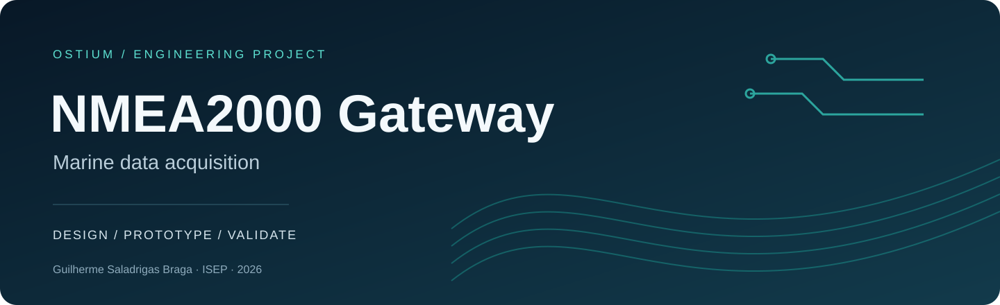
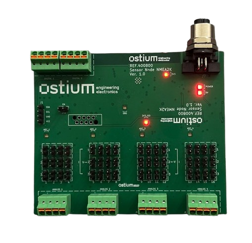
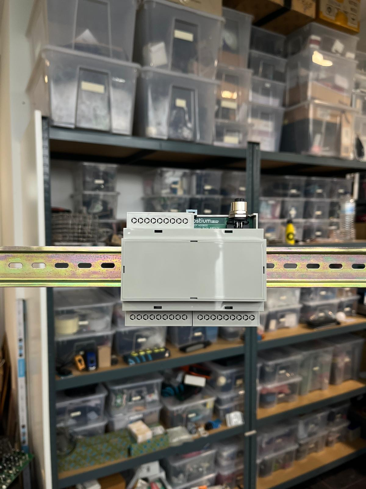
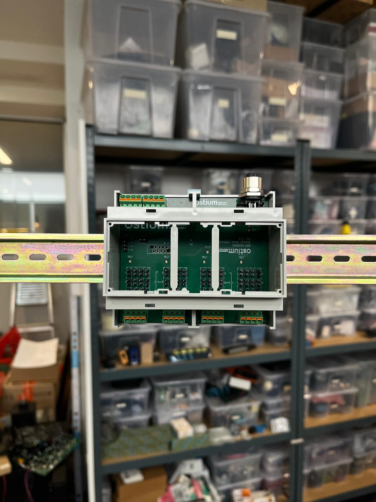

<strong>From physical signals to connected marine systems.</strong> A custom data-acquisition prototype, from electronic design to bench validation.

<a href="#overview">Overview</a> · <a href="#capabilities">Capabilities</a> · <a href="#validation">Validation</a> · <a href="#next-steps">Next steps</a>

## Overview

NMEA2000-Gateway presents an embedded engineering project developed at **OSTIUM Soluções de Engenharia**, as part of the Electrical and Computer Engineering degree at **ISEP — Instituto Superior de Engenharia do Porto**.

The project addresses the acquisition of analog and digital signals for future integration into NMEA 2000 marine systems. It combines a dedicated PCB, embedded acquisition and diagnostics, an isolated CAN interface, and auxiliary Wi-Fi/MQTT monitoring.

The work covered system architecture, electronic design, prototype assembly, firmware development, and experimental validation. This repository presents the engineering scope and demonstrated results at a public overview level.

> **Status: bench-tested prototype.** CAN communication between two boards was validated. Full NMEA 2000 interoperability with commercial equipment remains a future validation step. No NMEA certification is claimed.

## Prototype

<em>Assembled PCB without the enclosure.</em>

<em>Rear View of the Assembled PCB.</em>

<em>Prototype mounted on a DIN rail, with the enclosure closed.</em>

<em>Prototype with the enclosure open.</em>

## Capabilities

| Area | Project scope |
| --- | --- |
| Analog acquisition | Acquisition of voltage and current signals from external sensors. |
| Digital acquisition | Monitoring of external digital states through isolated inputs. |
| Marine connectivity | Isolated CAN interface as the foundation for intended NMEA 2000 integration. |
| Remote monitoring | Auxiliary Wi-Fi/MQTT communication to observe acquired data during development. |
| Diagnostics | Local and remote feedback to support commissioning and bench testing. |
| Custom electronics | A dedicated PCB designed and assembled for the application. |

MQTT supports monitoring and diagnostics; it does not replace the intended marine network interface.

## Validation

Testing progressed from individual subsystems to communication between prototypes. These results describe the documented internship validation scope.

| Test area | Demonstrated result | Scope |
| --- | --- | --- |
| Board bring-up | Power-up, programming and diagnostic communication checked. | Bench tests. |
| Internal communication | Acquisition and display peripherals verified. | Prototype hardware. |
| Analog inputs | Voltage and current acquisition verified at selected test points. | Full-range calibration remains open. |
| Digital inputs | State changes verified with externally applied signals. | Functional checks. |
| CAN communication | Frames transmitted and received between two boards. | CAN layer; not full NMEA 2000 interoperability. |
| Wi-Fi/MQTT | Acquired data made available for remote monitoring. | Development and diagnostic use. |

This validation established the functional basis of the prototype and identified improvements for a future board revision. It does not establish qualification for deployment aboard a vessel.

## Engineering work

- Defined the system architecture and interfaces around acquisition requirements.
- Designed a dedicated PCB, considering signal conditioning, isolation and protection.
- Developed embedded acquisition, configuration and diagnostic functions.
- Assembled and brought up the prototype through staged subsystem checks.
- Investigated integration issues through measurement and repeated bench tests.
- Documented results, limitations and the next development steps.

## Next steps

- Complete application-level NMEA 2000 integration and test interoperability with commercial equipment.
- Characterize and calibrate analog inputs across their operating ranges.
- Incorporate experimental findings into a revised PCB.
- Extend validation to representative marine-network operating conditions.

## Project context

| | |
| --- | --- |
| Author | [Guilherme Saladrigas Braga](https://github.com/PSGui) |
| Institution | ISEP — Instituto Superior de Engenharia do Porto |
| Degree | Electrical and Computer Engineering |
| Internship company | OSTIUM Soluções de Engenharia, Lda. |
| Academic project | 2026 |

### Public documentation scope

This is a portfolio overview. Firmware source, circuit schematics, PCB manufacturing files, component lists and internal implementation details are outside the scope of this repository. The full technical report is not distributed here.
