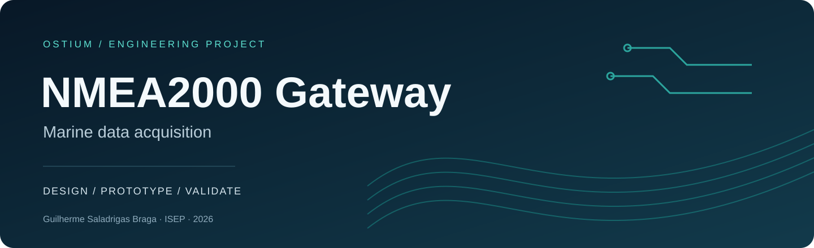
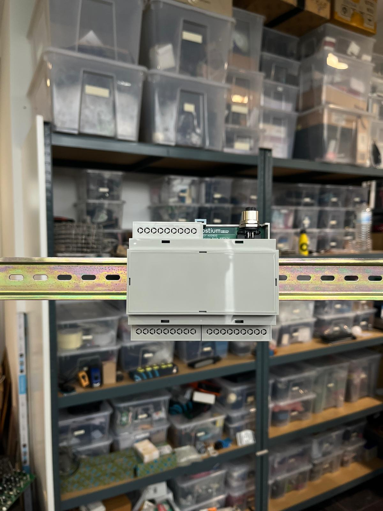
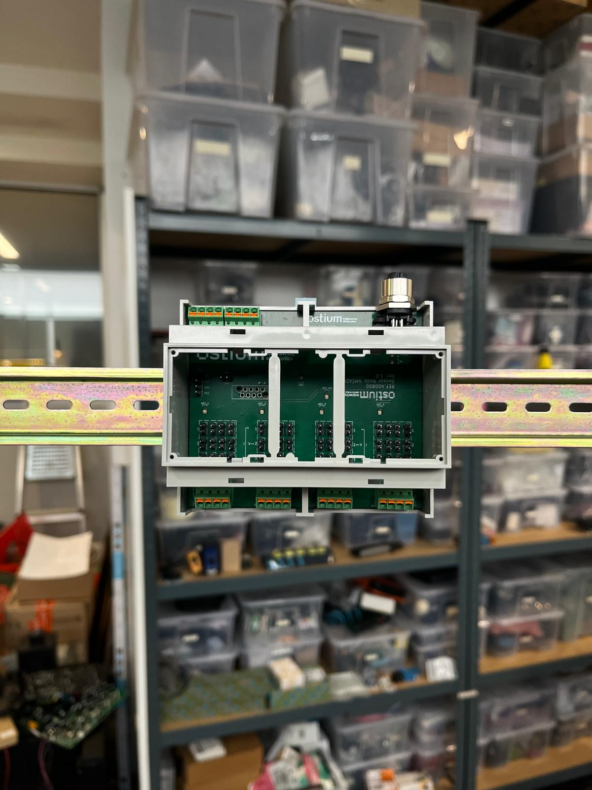

<a href="https://github.com/PSGui/NMEA2000-Gateway#readme">English</a> · <strong>Português</strong>

<strong>Dos sinais físicos à integração em sistemas marítimos.</strong> Um protótipo de aquisição de dados, da conceção eletrónica à validação em bancada.

<a href="#visão-geral">Visão geral</a> · <a href="#funcionalidades">Funcionalidades</a> · <a href="#validação">Validação</a> · <a href="#próximas-etapas">Próximas etapas</a>

## Visão geral

O NMEA2000-Gateway apresenta um projeto de sistemas embebidos desenvolvido na **OSTIUM Soluções de Engenharia**, no âmbito da Licenciatura em Engenharia Eletrotécnica e de Computadores do **ISEP — Instituto Superior de Engenharia do Porto**.

O projeto aborda a aquisição de sinais analógicos e digitais para futura integração em sistemas marítimos NMEA 2000. Combina uma PCB dedicada, aquisição e diagnóstico através de firmware, uma interface CAN isolada e monitorização auxiliar por Wi-Fi/MQTT.

O trabalho abrangeu a arquitetura do sistema, a conceção eletrónica, a montagem do protótipo, o desenvolvimento de firmware e a validação experimental. Este repositório apresenta o âmbito do trabalho e os resultados demonstrados, com um nível de detalhe adequado à divulgação pública.

> **Estado: protótipo testado em bancada.** Validou-se a comunicação CAN entre duas placas. A interoperabilidade NMEA 2000 com equipamentos comerciais permanece por validar. Não se declara qualquer certificação NMEA.

## Protótipo

<em>Protótipo montado em calha DIN, com a caixa fechada.</em>

<em>Protótipo com a caixa aberta.</em>

## Funcionalidades

| Área | Âmbito do projeto |
| --- | --- |
| Aquisição analógica | Aquisição de sinais de tensão e corrente provenientes de sensores externos. |
| Aquisição digital | Monitorização de estados digitais externos através de entradas isoladas. |
| Comunicação marítima | Interface CAN isolada como base para a integração prevista em NMEA 2000. |
| Monitorização remota | Comunicação auxiliar Wi-Fi/MQTT para observar dados durante o desenvolvimento. |
| Diagnóstico | Informação local e remota para apoiar a colocação em funcionamento e os testes. |
| Eletrónica dedicada | PCB concebida e montada para a aplicação. |

A comunicação MQTT apoia a monitorização e o diagnóstico; não substitui a interface prevista para a rede marítima.

## Validação

Os ensaios avançaram da verificação dos subsistemas para a comunicação entre protótipos. A tabela resume o âmbito de validação documentado no estágio.

| Área de ensaio | Resultado demonstrado | Alcance |
| --- | --- | --- |
| Arranque da placa | Verificaram-se a alimentação, a programação e a comunicação de diagnóstico. | Ensaios em bancada. |
| Comunicação interna | Verificou-se a comunicação com os periféricos de aquisição e visualização. | Hardware do protótipo. |
| Entradas analógicas | Validou-se a aquisição em tensão e corrente em pontos selecionados. | Calibração em toda a gama ainda por realizar. |
| Entradas digitais | Confirmaram-se mudanças de estado com sinais externos. | Verificação funcional. |
| Comunicação CAN | Transmitiram-se e receberam-se tramas entre duas placas. | Camada CAN; não corresponde à interoperabilidade NMEA 2000 completa. |
| Wi-Fi/MQTT | Disponibilizaram-se os dados adquiridos para monitorização remota. | Apoio ao desenvolvimento e diagnóstico. |

Esta validação confirmou a base funcional do protótipo e identificou melhorias para uma futura revisão da placa. Não demonstra a qualificação do equipamento para instalação numa embarcação.

## Trabalho de engenharia

- Definiu-se a arquitetura e as interfaces a partir dos requisitos de aquisição.
- Concebeu-se uma PCB dedicada, considerando o condicionamento de sinais, o isolamento e a proteção.
- Desenvolveram-se funções de aquisição, configuração e diagnóstico em firmware.
- Montou-se e colocou-se em funcionamento o protótipo através de verificações por subsistema.
- Investigaram-se problemas de integração através de medições e repetição dos ensaios.
- Documentaram-se os resultados, as limitações e as etapas seguintes.

## Próximas etapas

- Completar a integração NMEA 2000 ao nível da aplicação e testar a interoperabilidade com equipamentos comerciais.
- Caracterizar e calibrar as entradas analógicas ao longo das respetivas gamas.
- Incorporar os resultados experimentais numa revisão da PCB.
- Alargar a validação a condições representativas de funcionamento numa rede marítima.

## Contexto do projeto

| | |
| --- | --- |
| Autor | [Guilherme Saladrigas Braga](https://github.com/PSGui) |
| Instituição | ISEP — Instituto Superior de Engenharia do Porto |
| Curso | Licenciatura em Engenharia Eletrotécnica e de Computadores |
| Empresa de estágio | OSTIUM Soluções de Engenharia, Lda. |
| Projeto académico | 2026 |

### Âmbito da documentação pública

Este repositório apresenta uma síntese para portefólio. O código-fonte do firmware, os esquemáticos, os ficheiros de fabrico da PCB, as listas de componentes e os detalhes internos de implementação estão fora do seu âmbito. O relatório técnico completo não é distribuído aqui.
